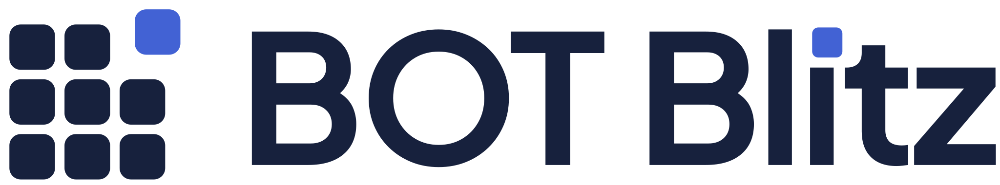

# BOT Blitz logo

<p>
  
</p>

## The idea

The mark is the game's 3×3 board with the **lit cell popped up and to the right, out of its slot**: a tap, confirmed. It's built only from the product's own geometry, with no bolts, coins, chains or robots.

The wordmark is Plus Jakarta Sans Bold, the product's typeface, converted to outlines so it needs no font. It is all ink except one detail: the dot of the **i** is a square lit cell that has popped up and right, like the one in the mark.

Colour is flat throughout, with no gradients.

## Files

All assets are SVG. The PNGs are exports for places that need bitmaps.

| Asset | Colour | Ink (mono) | White (mono) |
|---|---|---|---|
| Horizontal lockup | `lockup-color.svg` | `lockup-ink.svg` | `lockup-white.svg` |
| Lockup on dark (colour) | `lockup-reversed.svg` | | |
| Primary mark | `mark-color.svg` | `mark-ink.svg` | `mark-white.svg` |
| Mark on dark (colour) | `mark-reversed.svg` | | |
| Compact mark (≤ 24px) | `mark-compact-color.svg` | `mark-compact-ink.svg` | `mark-compact-white.svg` |
| Wordmark only | `wordmark-color.svg` | `wordmark-ink.svg` | `wordmark-white.svg` |

| Icon | File |
|---|---|
| Favicon (pixel-snapped, switches automatically for dark browser UI) | `favicon.svg`, `favicon-light.svg`, `favicon-16.png`, `favicon-32.png` |
| Apple touch icon | `apple-touch-icon.png` (180) |
| PWA icons | `icon-192.png`, `icon-512.png`, `icon-maskable-512.png`, `app-icon.svg`, `app-icon-maskable.svg` |
| Large bitmaps | `mark-color-1024.png`, `lockup-color@2x.png`, `lockup-reversed@2x.png` |

## Which mark, at which size

- **Primary mark:** 24px and up.
- **Compact mark:** below 24px. It keeps the primary mark's silhouette with the gaps between cells closed, because those gaps blur into noise at favicon size.
- **Favicon:** the compact mark redrawn on a 16px grid, so every edge lands on a whole pixel. It stays sharp at 16px and 32px.
- **Lockup:** the mark and wordmark together, with the spacing already fixed. Minimum height is 20px on screen.

**Clear space:** keep a margin around any version equal to one board cell (a quarter of the mark's height).

## Colour

| Role | Hex | Contrast |
|---|---|---|
| Ink (board, wordmark) | `#17213D` | 15.9:1 on white, 14.1:1 on haze `#EDF2F7` |
| Lit cell | `#4262D4` | 5.3:1 on white, 4.7:1 on haze |
| Lit cell on dark | `#8FA6F0` | 6.7:1 on ink |

The standard indigo lit cell is not used on ink backgrounds, where it measures only 3.0:1. On dark backgrounds use the reversed files, which switch the lit cell to `#8FA6F0`.

## Don't

- Add gradients, shadows, outlines or glows.
- Recolour the board or wordmark in indigo. The indigo is reserved for the lit cell.
- Move the lit cell back into its slot, or change which cell is lit or which way it pops.
- Rotate, stretch or re-space the lockup.
- Retype the wordmark in a live font. Use the outlined files.
- Use the primary mark below 24px, or the compact mark above 48px.

## Regenerating

Every asset comes from one geometry spec in `tools/gen.mjs`: 12-unit cells, 2.5-unit gaps and a (+4, −4) pop. The same script also writes `web/src/components/logoData.ts`, so the logo in the app and these files can't drift apart.

```bash
cd brand/tools
npm install
npm run fetch-font   # Plus Jakarta Sans Bold, SIL Open Font License 1.1 (not committed)
npm run build        # rewrites brand/*, web/src/components/logoData.ts and the web/public icons
```

The logo is MIT-licensed with the rest of the project. The outlined wordmark is derived from Plus Jakarta Sans, whose licence (OFL 1.1) permits this.
